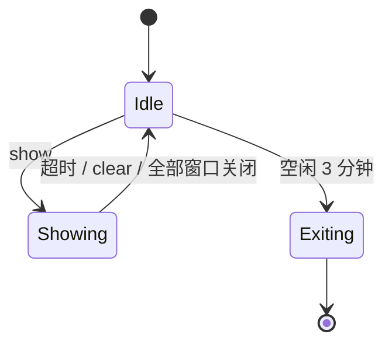

# 01 · 形态与架构

> 状态：**已定（D1/D2/D3/D4，2026-10-19）** · 草案 v0.2
>
> 本章回答三个问题：Spotlight 以一个什么进程形态存在、AI 怎么调用它、内部怎么分工。

## 1. 候选形态

| | A 按需常驻 + CLI | B 一次性进程 | C 常驻 + 托盘 + 热键 | D 本地服务 / MCP |
| --- | --- | --- | --- | --- |
| 首帧延迟 | ~5 ms（已就绪） | 60–150 ms（进程冷启动） | ~5 ms | ~5 ms |
| 命令是否阻塞 | 否，立即返回 | 是（或自行 fork 后返回） | 否 | 否 |
| 跨调用更新 / 清理 | 容易 | 困难（要找回那个进程） | 容易 | 容易 |
| 多步引导 | 自然 | 别扭 | 自然 | 自然 |
| 空闲内存 | 8–12 MB | 0 | 8–12 MB + 托盘 | 同 A |
| 实现复杂度 | 中 | 低 | 中高 | 中高 |
| 用户可控性 | 中 | 低 | 高（随时关） | 中 |
| 崩溃残留 | 无（窗口随进程销毁） | 无 | 无 | 无 |

### 已定：A 的变体——"按需拉起、空闲自退"

> **D1 决策（2026-10-19）**：采用 A。B 和 C 作为可选配置项保留——C 的托盘图标通过
> `ui.tray = true` 打开，B 的能力通过 `--timeout` + 阻塞等价的 `wait` 方法提供。

```
spotlight show ...        # CLI 进程，约 5ms 内返回
   └─ 管道不通？ → 用 CreateProcess 拉起同目录的 spotlight.exe --daemon
                   → 等 ready（≤300ms）→ 重发请求
```

- 用户从不主动启动它。第一次调用时它自己出现，最后一个遮罩消失后再等 3 分钟自己退出。
- 没有常驻压力，也没有"后台有个我不知道的程序"的心理负担。
- 保留 C 的托盘图标作为**可选**配置项（`ui.tray = true`），给"人给人指导"的场景用。
- D 不作为独立形态，而是 A 之上的一层薄封装（见 §6）。

**否决 B 的理由**：命令要么阻塞（Agent 卡住等用户），要么 fork 后失去联系（没法更新、
没法清理、多个调用互相覆盖）。多步引导是核心场景，B 撑不住。

## 2. 组件

一个二进制，三种角色：

```
spotlight.exe
├── 默认：CLI 客户端（解析参数 → 走 IPC → 打印结果 → 退出）
├── --daemon：守护进程（无控制台窗口，持有全部 overlay 窗口）
└── --mcp：stdio 上的 MCP server（惰性转发到守护进程）
```

守护进程内部：

```
┌──────────────────────── spotlightd ────────────────────────┐
│                                                            │
│  IPC 服务 (named pipe, NDJSON)                              │
│      │                                                     │
│  SessionStore ── 场景 / 目标 / 过期时间 / 代际计数             │
│      │                                                     │
│  Layout       ── 遮罩矩形分解、气泡避让、多屏裁剪              │
│      │                                                     │
│  Renderer     ── 每个显示器一组窗口（惰性创建，可复用）          │
│      │                                                     │
│  Config / DPI / Monitor 枚举 / 日志                         │
└────────────────────────────────────────────────────────────┘
```

**没有**网络、数据库、后台线程池（一个消息循环 + 一个定时器足够）。

### 2.1 平台切分（D4：Windows 先行，macOS 后补）

> **D4 决策（2026-10-19）**：目标平台是 Windows + macOS，但**手上暂时没有 Mac**，
> 所以先把 Windows 做透，mac 层先留空实现。前提是**从第一天就把平台层切开**——
> 否则等 Mac 到手时，Win32 调用已经长进业务逻辑里了，等于重写。


两个平台能共享的是"逻辑"，不能共享的是"窗口"和"截图"。切分线画在这里：

```
crates/
├── spotlight-core      # 纯逻辑，零 unsafe，零平台依赖
│   ├── scene 模型 / 校验
│   ├── 矩形分解（屏幕减洞）
│   ├── 气泡避让布局
│   ├── 协议编解码、CLI 参数解析
│   └── 配置、日志格式化
├── spotlight-win       # Win32 实现
├── spotlight-mac       # AppKit / ScreenCaptureKit 实现
└── spotlight-cli       # 入口，按 cfg 选平台实现
```

平台层要实现的东西只有 6 个：

| 能力 | Windows | macOS |
| --- | --- | --- |
| 枚举显示器 + DPI | `EnumDisplayMonitors` + `GetDpiForMonitor` | `NSScreen.screens` + `backingScaleFactor` |
| 创建点击穿透的置顶窗口 | `WS_EX_LAYERED\|TRANSPARENT\|NOACTIVATE\|TOOLWINDOW` | `NSWindow.ignoresMouseEvents` + `level` |
| 从截图排除窗口 | `SetWindowDisplayAffinity(WDA_EXCLUDEFROMCAPTURE)` | `window.sharingType = .none` |
| 抓屏 | GDI `BitBlt`（`CAPTUREBLT`） | ScreenCaptureKit |
| 全局快捷键 | `RegisterHotKey` | `NSEvent.addGlobalMonitorForEvents` |
| 鼠标观察（预留） | `WH_MOUSE_LL`（只读） | `CGEvent.tapCreate`（只读） |

**两边的坐标系是反的**，这是最容易写出 bug 的地方：

| | 原点 | y 方向 | 单位 |
| --- | --- | --- | --- |
| Windows | 主屏左上 | 向下 | 物理像素（PerMonitorV2） |
| macOS | 主屏左下 | 向上 | 点（point），像素 = 点 × backingScaleFactor |

所以 `spotlight-core` 内部只认一种中间表示：**"物理像素 + 左上原点 + y 向下"**，
macOS 层负责在边界上做翻转和倍数换算。所有布局算法只写一遍。


## 3. 一次 show 的时序

```
AI          CLI            pipe          daemon          DWM
 │           │               │              │              │
 ├─ exec ───►│               │              │              │
 │           ├─ connect ────►│              │              │
 │           │   (失败)       │              │              │
 │           ├─ spawn --daemon ─────────────►│              │
 │           │◄──────── ready ──────────────┤              │
 │           ├─ show ────────►├─────────────►│              │
 │           │               │              ├─ 校验/布局    │
 │           │               │              ├─ 建窗口 ─────►│
 │           │◄── {"ok",id} ──┴──────────────┤              │
 │◄─ stdout ─┤               │              │              │
 │           │               │              ├─ 5s 后定时器  │
 │           │               │              ├─ 销毁窗口 ───►│
```

关键点：

- **CLI 在画面出现之前返回**（daemon 顺序执行"渲染 → 回包"），所以 Agent 不会先说话
  后出画面。
- 定时消失由 daemon 负责，和 CLI 进程死活无关。

## 4. CLI 草案

```
spotlight <command> [options]
```

| 命令 | 作用 | 备注 |
| --- | --- | --- |
| `show` | 显示一个 scene | 主命令 |
| `clear` | 关闭指定或全部遮罩 | `--all` / `--id` |
| `status` | 守护进程与当前 scene 状态 | 机器可读 |
| `capture` | 截图并返回坐标变换元数据 | 见 02 章 |
| `doctor` | 自检（DPI、多屏、捕获排除是否生效） | 排查用 |
| `config` | 读写配置 | `get` / `set` / `path` |
| `daemon` | 内部：前台跑守护进程 | `--daemon` 的显式形式 |

### show 的参数

```bash
spotlight show \
  --rect 812,132,32,32 \            # x,y,w,h（必填，除非 --file）
  --text "点这个『边框』按钮" \       # 气泡正文
  --title "第 1 步 · 去掉边框" \      # 可选标题行
  --step 1/3 \                      # 可选步骤指示
  --placement auto \                # auto|top|bottom|left|right
  --accent "#FF3B30" \              # 光环颜色
  --dim 0.55 \                      # 遮罩不透明度
  --padding 8 \                     # 光环相对 target 的外扩
  --timeout 15 \                    # 秒；0 = 一直显示直到被关闭
  --space image \                   # image|screen，默认 image
  --capture <id> \                  # 指定用哪次 capture 的坐标系
  --id step1 \                      # 幂等键：同 id 再 show 会替换而不是叠加
  --json                            # 输出 JSON
```

多目标 / 复杂场景用文件：

```bash
spotlight show --file - <<'JSON'
{ "targets": [{ "rect": [812,132,32,32], "text": "先点这里", "step": "1/2" },
              { "rect": [900,180,120,28], "text": "然后选『无框线』", "step": "2/2" }],
  "timeout": 0 }
JSON
```

### 退出码（给 Agent 看的）

| code | 含义 | Agent 应该做什么 |
| --- | --- | --- |
| 0 | 成功 | 继续 |
| 2 | 参数错误（含 JSON 格式） | 修正参数重试 |
| 3 | 坐标越界 / 引用了不存在的 capture | 重新截图取坐标 |
| 4 | 守护进程起不来 | 调 `doctor`，或退化为文字说明 |
| 5 | `--id` 不存在 | 忽略 |

错误体固定带 `hint` 字段，例如：

```json
{"ok":false,"error":"rect_out_of_bounds",
 "hint":"矩形 (812,132,32,32) 超出显示器范围 (0,0,1920,1080)。请用 spotlight capture 重新取图后按图像像素给出坐标。",
 "monitors":[{"index":0,"bounds":[0,0,1920,1080],"scale":1.25}]}
```

## 5. IPC 协议

- 传输：Windows 命名管道 `\\.\pipe\spotlight-<UserSID>`（带 SID 是为了多用户会话共存）
- 编码：UTF-8 NDJSON，一行一个消息
- 版本：每条消息带 `v`，不匹配就拒绝并提示升级

```jsonc
// 请求
{"v":1,"id":7,"method":"show","params":{"targets":[...]}}
// 响应
{"v":1,"id":7,"ok":true,"result":{"scene":"s-3","shown_at_ms":12}}
```

对于 `--timeout 0` 且 Agent 想等结果的场景，提供可选的 `wait` 方法（长轮询，
默认不启用——让 Agent 长时间阻塞是危险的）。

## 6. AI 接入方式

| 方式 | 优点 | 代价 | 状态 |
| --- | --- | --- | --- |
| CLI + `--json` | 任何能执行命令的 Agent 都能用；调试直观 | 要靠 shell 调用 | **已定：v1 唯一入口** |
| MCP server (`--mcp`) | Claude Desktop 等直接挂载，工具描述更清晰 | 薄封装，几十行 | 暂不做，重估于 v1.1 |
| 本地 HTTP | 跨语言方便 | 端口、鉴权、防火墙提示 | 不做 |

> **D2 决策（2026-10-19）**：只做 CLI。理由：Agent 侧"能执行命令"是最大公约数，
> 而 MCP 的收益随客户端生态变化，现在押注不划算。但协议设计要保证 MCP 将来只是
> `show` 参数的一对一映射——也就是说，**CLI 的语义必须先在纸面上是对的**。

## 7. 技术选型（初步）

| 层 | 选择 | 理由 / 被否方案 |
| --- | --- | --- |
| 语言 | Rust，`x86_64-pc-windows-msvc` + `aarch64-apple-darwin`，静态 CRT | 单文件、无运行时依赖 |
| 窗口（Win） | 直接调 Win32（`windows-sys` 原始绑定） | winit/tao 对分层窗口、逐像素 alpha、点击穿透支持不足；`windows` 封装版的样板更多，这一层不需要 |
| 窗口（mac） | `objc2` + `objc2-app-kit`，直接建 `NSWindow`/`NSPanel` | 同上；且要精确控制 `window.level` 与 `collectionBehavior` |
| 图形 | `tiny-skia` 画光环、圆角、卡片背景（纯 Rust，两平台通用） | skia-safe 二进制膨胀十倍 |
| 文字（Win） | GDI `DrawTextW` 画成 alpha 掩膜，再合成进画布 | 不增体积、不扫字体目录，冷启动快；代价是只支持换行和左对齐，富文本时再换 DirectWrite |
| 文字（mac） | CoreText 同构实现（待 M6） | 与 Win 保持"系统排版 + 掩膜合成"的结构 |
| 截图（Win） | GDI `BitBlt` + `CAPTUREBLT` | WinRT `Graphics.Capture` 更准但要写更多样板且依赖 WinRT；先用 BitBlt，遇到问题再换 |
| 截图（mac） | ScreenCaptureKit | `CGWindowListCreateImage` 已废弃 |
| 序列化 | `serde` + `serde_json` | 协议和 CLI 都够用 |
| 配置 | TOML（`toml`） | 人可读、可手改 |
| 日志 | `tracing` + 滚动文件，默认关 | 只在 `doctor` / `--verbose` 时开 |
| 发布配置 | `opt-level="z"`, `lto="fat"`, `codegen-units=1`, `panic="abort"`, `strip=true` | 目标 < 5 MB |


**为什么不用 Tauri / Electron / WinUI3**：它们都要求一个运行时（WebView2 / .NET /
Windows App SDK），把"免安装单文件"这条前提直接破坏掉。

**为什么不用 winit + egui**：这套组合能画出漂亮的界面，但"全屏、逐像素透明、
点击穿透、永不抢焦点"恰恰是它最不擅长的部分，绕开的成本比直接写 Win32 高。

## 8. 渲染思路（预演，细节见 03）

这是本文档里唯一影响"内存是否随分辨率膨胀"的决定：

**不做全屏位图。**

- 遮罩用 **若干块纯色矩形窗口** 拼出来（统一 alpha 的分层窗口，GDI 填黑即可），
  一块位图都不用。
- 屏幕减去洞 → 矩形集合：按 y 切成横条，每条算洞的 x 区间，取补集。N 个目标最多
  产生约 2N+2 个矩形，都交给系统合成。
- 光环和气泡单独放在**一个贴合包围盒的小窗口**里，走逐像素 alpha。
- 呼吸/脉冲动效只重绘这个小窗口。

结果：1920×1080 和 3840×2160 的内存占用几乎一样。这是 C5 能达标的关键。

## 9. 生命周期



- 单实例：命名互斥量 `Global\spotlight-<SID>`，第二个实例直接退出并转交请求
- 用户注销/关机：系统回收，无需处理
- 崩溃：窗口随进程消失，不会留下永久黑屏（这一点必须靠"窗口属于进程"来保证，
  绝不能用独立进程画常驻遮罩）

## 10. 决策与遗留

### 已定（2026-10-19）

| # | 决策 | 影响面 |
| --- | --- | --- |
| D1 | 进程形态 = 按需拉起 + 空闲自退的守护进程 | 全局 |
| D2 | AI 入口 = CLI + `--json`，不做 MCP/HTTP | §6 |
| D3 | 纯展示、不碰输入，只保留关闭按钮一个可点区域 | 见 03 章 |
| D4 | 平台 = Windows 先行、macOS 后补，核心抽到 `spotlight-core` | 全部平台代码 |

### 新增待决策

| # | 问题 | 影响 |
| --- | --- | --- |
| D9 | 默认截图范围：主屏 vs 鼠标所在屏 | 见 02 章 §4 |
| D10 | 默认 `--max-width` | 见 02 章 §4 |
| D11 | ~~多目标进 v1？~~ → **已定：多目标进 v1，步骤流不做** | 见 04 章 §4、07 章 |


