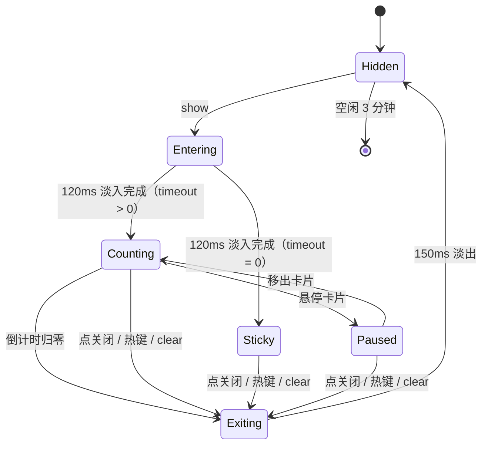

# 04 · 交互与状态机

> 状态：**讨论中** · 草案 v0.1
>
> D7 已定：**时长由 AI 控制**（`--timeout`），`0` 表示常驻；**悬停文案暂停倒计时**；
> 任何模式都有手动关闭；限时模式显示**进度条**。

## 1. 状态机



状态只有 5 个，全部在守护进程里，**单线程消息循环驱动**，没有并发问题。

## 2. 计时规则

| `--timeout` | 行为 | 进度条 |
| --- | --- | --- |
| `20` | 显示 20 秒 | 有，从满到空 |
| `0` | 常驻，直到被关闭 | 无 |
| `auto`（默认） | 按文案长度估算 | 有 |
| 未传 | 等于 `auto` | 有 |

### auto 的估算

中文阅读速度约 5–8 字/秒，但"读完"不等于"点完"——用户还要找到目标、移动鼠标、
点下去。所以：

```
t = clamp(5 + ceil(chars / 6), 6, 45)   // 秒
```

| 文案 | 字数 | 停留 |
| --- | --- | --- |
| "点这里" | 3 | 6s |
| "点这个『边框』按钮" | 9 | 7s |
| "先在右侧选择『无框线』，再点确定" | 17 | 8s |
| 一整段三行说明 | 60 | 15s |

AI 永远可以显式覆盖。**这个公式的意义是：AI 忘了传 `--timeout` 时，也不会出现
"字还没读完就没了"或"挂在那儿半天不走"。**

### 悬停暂停

- 鼠标进入卡片矩形 → 暂停，进度条**冻结**（不清零、不重置）
- 鼠标离开 → 从剩余时间继续
- **暂停有上限：累计 60 秒后不再暂停**，倒计时照常走。否则光标恰好停在卡片上，
  遮罩就永远不会消失（实测踩到过：一个框在屏幕上挂了五分多钟）
- 暂停期间卡片提亮到 100% 不透明度，作为"我停住了"的反馈
- 检测方式见 [03 §5](03-渲染与视觉.md)：`GetCursorPos` 轮询，不用全局钩子
- 悬停只对**卡片**生效，鼠标在遮罩上或目标上不算

## 3. 关闭路径

| 触发 | 说明 |
| --- | --- |
| 倒计时归零 | 仅限时模式 |
| 点卡片右上角的 × | 任何模式都有，命中区 28×28 |
| 全局热键（默认 `Ctrl+Alt+Esc`） | 只在画面存在时注册，消失后立即注销 |
| `spotlight clear` | AI 主动关 |
| 新的 `show` 到达 | 默认替换当前画面（见 §5） |
| 显示器配置变化 / 会话锁定 | 直接关掉，绝不试图恢复 |

最后一条是刻意的：锁屏后恢复一个旧位置的遮罩，比不显示更糟——用户看到的是一块
指向空气的框。

## 4. 多目标与步骤

一个 **scene** 可以含多个 target，共用一个倒计时和一张卡片：

```bash
spotlight show --capture c-7 --file - <<'JSON'
{ "timeout": "auto",
  "targets": [
    { "rect": [812,132,32,32], "step": "1/3" },
    { "rect": [900,180,120,28], "step": "2/3" }
  ],
  "callout": { "title": "去掉表格边框", "text": "先点这里，再选『无框线』" } }
JSON
```

- 每个 target 可以有自己的 `step` 药丸
- 卡片只有一张（多张卡片会互相打架）
- 多步骤引导不靠"一次传完"，而是 **AI 每步调一次 `show`**——因为下一步的位置依赖
  用户点击后的界面变化，AI 必须重新截图

## 5. 替换语义与幂等

| 情况 | 行为 |
| --- | --- |
| 画面已存在，来了新的 `show` | 替换（旧画面 150ms 淡出，新画面淡入） |
| 新 `show` 带相同 `--id` | 原地更新，**不重播入场动画**（避免闪烁） |
| 多个 CLI 并发调用 | 管道内串行处理，后来的覆盖先来的 |
| `clear --id x` 不存在 | 退出码 5，不报错到 stderr |

`--id` 是实现"步骤推进"的关键：AI 用同一个 id 连续更新，用户看到的是**同一个框在移动**，
而不是"消失又出现"。

## 6. 全局热键

- 默认 `Ctrl+Alt+Esc`，配置项 `hotkey.dismiss`
- **只在有画面时注册**，画面消失立即 `UnregisterHotKey`——不长期占用用户的快捷键
- 注册失败（被别的程序占了）→ 静默降级为"只能用关闭按钮"，并在 `doctor` 里报告
- 已实现并实测：注册成功后模拟按键，画面立即消失、热键随即注销
- 不注册 `Esc` 单键：它会跟用户正在用的软件抢按键

## 7. 平台事件

| 事件 | 处理 |
| --- | --- |
| 显示器增删 / 分辨率变化 / DPI 变化 | 关闭当前画面，丢弃 capture 引用 |
| 会话锁定 | 关闭 |
| 系统休眠/唤醒 | 关闭 |
| 克隆/扩展模式切换 | 关闭 |

统一策略：**这些事件发生时，一切坐标都可能失效，直接重来。** 不做平滑迁移。

## 8. 给 AI 的调用建议

写进工具描述里的一段话：

> 1. 先 `spotlight capture` 拿图和 `capture` id
> 2. 在返回的图片像素上量矩形，用 `--capture <id>` 传回去
> 3. `--text` 控制在 30 字以内，一句话说清"点哪里、会怎样"
> 4. 多步操作时，每一步都重新截图、重新调用，**不要一次把三步都画出来**
> 5. 用 `--id step` 让同一步的更新原地替换

## 9. 待决策

| # | 问题 | 倾向 |
| --- | --- | --- |
| D13 | 是否提供托盘图标 | 默认关，配置可开 |
| D14 | 多显示器是否允许每屏一个独立场景 | 不做。一个场景可以跨屏，但不并行多场景 |
| D17 | 悬停暂停是否有上限（比如最多暂停 60 秒） | ✅ 已定：累计 60 秒封顶，之后照常倒计时 |
| D18 | 是否支持"跟随窗口"（目标窗口滚动/移动时遮罩跟着走） | 不做进 v1。需要轮询目标窗口矩形，且窗口内部滚动无法感知 |
| D19 | 卡片关闭后是否给 AI 一个信号 | 不推送（无回调）。`status` 里能查到"已关闭"即可 |
